  

 

---

### I. Office of the Chairman — Executive Mandate

> **Shashwajen Akinapelly** is the **Founder & Chairman of Deskspace Technologies Pvt. Ltd.**, directing corporate strategy, applied artificial intelligence research, and foundational software systems. With an engineering track record spanning eight years, his work centers on building deterministic multi-agent platforms, hardware-accelerated local inference runtimes, and resilient enterprise infrastructure.

| Corporate Governance & Venture Leadership | Systems & Technical Architecture |
| :--- | :--- |
| **Deskspace Technologies Pvt. Ltd.** — *Founder & Chairman* Directing company vision, R&D roadmap, intellectual property, and commercial software delivery. | **Applied AI & Autonomous Workflows** Multimodal enterprise document ingestion, `pgvector` semantic indexing, and deterministic agent orchestration. |
| **Product & Engineering Divisions** Leading end-to-end execution across cloud-native platforms, native Android applications, and Linux environments. | **Low-Level Runtime & OS Engineering** Custom Linux desktop compositors, kernel parameter tuning, local LLM clusters, and native `Kotlin` / `Jetpack Compose` systems. |

---

### II. Verified Engineering Velocity & Live Telemetry

 

  

 

---

### III. Corporate & Technical Track Record

| Period | Initiative / Entity | Sector | Architectural Outcome |
| :--- | :--- | :--- | :--- |
| **2026** | **[Deskspace Technologies Pvt. Ltd.](https://github.com/deckspaces)** | Enterprise Software | Founded and structured flagship technology holding and software engineering firm. |
| **2026** | **OmniDoc AI** | Enterprise AI | Built multimodal document workflow agent utilizing `Gemini API`, `Cloud Run`, and `pgvector`. |
| **2026** | **[MedicalPlain](https://medicalplain.vercel.app)** | HealthTech | Architected and deployed clinical document translation & simplification platform on edge infrastructure. |
| **2026** | **Local Multi-Agent Runtime** | AI Infrastructure | Engineered zero-cloud multi-agent orchestration via `llama.cpp` (Vulkan), `Ollama`, and `Goose`. |
| **2026** | **LiquidGlass Lock UI** | Mobile OS / UI | Developed custom Android lock-screen compositor engine in `Kotlin` and `Jetpack Compose`. |
| **2018–2025** | **Systems & Web R&D** | Infrastructure | 8-year engineering foundation across Linux kernel environments, Android internals, and full-stack web. |

<b>▸ Inspect Deep Architecture Blueprints (Click to Expand)</b>

 

* **OmniDoc AI Pipeline:** Ingests multi-page PDFs and scanned records, generates dense vector embeddings in PostgreSQL (`pgvector`), and executes multi-step reasoning via Gemini API on serverless Google Cloud Run instances.
* **Zero-Cloud Inference Stack:** Runs quantized GGUF models locally using `llama.cpp` with Vulkan GPU acceleration, exposing OpenAI-compatible endpoints to autonomous agent frameworks (`Goose`, `Open Interpreter`).
* **Mobile Compositor & OS Layer:** Implements custom shader-driven UI depth layers in Jetpack Compose alongside root-level ADB/Fastboot telemetry tooling.

---

### IV. Distinctions, Credentials & Recognitions

| Year | Credential / Distinction | Issuing Body | Domain |
| :--- | :--- | :--- | :--- |
| **2026** | **Startup Buildathon India — Finalist Submission** | Hack2Skill | Multimodal Enterprise AI (`OmniDoc AI`) |
| **2026** | **Generative & Agentic AI Micro-Specialisation** | NxtWave & IIT Kharagpur OCN | Autonomous Agent Systems (Shortlisted) |
| **2026** | **Building Effective Human-Agent Teams** | Anthropic / Claude Academy | Multi-Agent Systems Architecture |
| **2026** | **Claude 101 — Verified Certification** | Anthropic / Claude Academy | Applied LLM Engineering |

---

### V. Core Technology Architecture

 

| Architectural Layer | Capabilities & Production Tooling |
| :--- | :--- |
| **Executive & Venture Strategy** | Zero-to-One Product Architecture • Technical Governance • R&D Leadership • Commercial Scaling |
| **Artificial Intelligence & Agents** | Multimodal Pipelines • RAG & `pgvector` • Local LLM Inference (`llama.cpp`, `Ollama`) • Gemini API |
| **Systems & Mobile Engineering** | Ubuntu Linux Internals • Custom Compositors • `Kotlin` • `Jetpack Compose` • `C++` • `Bash` |
| **Cloud & Full-Stack Infrastructure** | `TypeScript` • `React` • `Next.js` • `Python` • Docker • Google Cloud Run • PostgreSQL • Vercel |

---

**DESKSPACE TECHNOLOGIES PVT. LTD.** &nbsp;•&nbsp; HYDERABAD, INDIA

