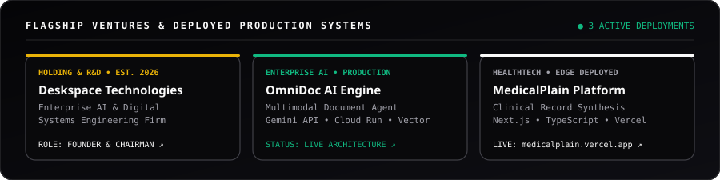
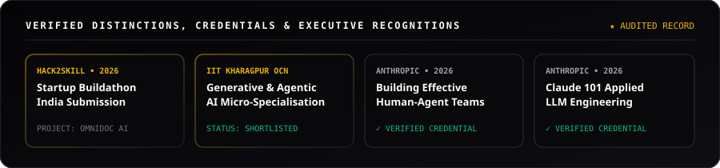
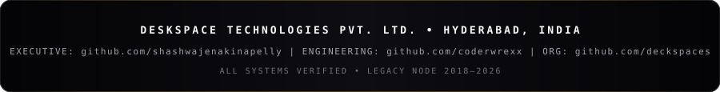

 

### I. Office of the Chairman — Executive Mandate

 

### II. Verified Engineering Velocity & Live Telemetry

  

 

### III. Flagship Ventures & Corporate Track Record

 

| Period | Initiative / Entity | Sector | Architectural Deliverable |
| :--- | :--- | :--- | :--- |
| **2026** | **[Deskspace Technologies Pvt. Ltd.](https://github.com/deckspaces)** | Enterprise Software | Founded and structured flagship technology holding and software engineering firm. |
| **2026** | **OmniDoc AI** | Enterprise AI | Built multimodal document workflow agent utilizing `Gemini API`, `Cloud Run`, and `pgvector`. |
| **2026** | **[MedicalPlain](https://medicalplain.vercel.app)** | HealthTech | Architected and deployed clinical document translation & simplification platform on edge infrastructure. |
| **2026** | **Local Multi-Agent Runtime** | AI Infrastructure | Engineered zero-cloud multi-agent orchestration via `llama.cpp` (Vulkan), `Ollama`, and `Goose`. |
| **2026** | **LiquidGlass Lock UI** | Mobile OS / UI | Developed custom Android lock-screen compositor engine in `Kotlin` and `Jetpack Compose`. |
| **2018–2025** | **Systems & Web R&D** | Infrastructure | 8-year engineering foundation across Linux kernel environments, Android internals, and full-stack web. |

<b>▸ Inspect Deep Architecture Blueprints (Interactive Technical Specification)</b>

 

* **OmniDoc AI Pipeline:** Ingests multi-page PDFs and scanned records, generates dense vector embeddings in PostgreSQL (`pgvector`), and executes multi-step reasoning via Gemini API on serverless Google Cloud Run instances.
* **Zero-Cloud Inference Stack:** Runs quantized GGUF models locally using `llama.cpp` with Vulkan GPU acceleration, exposing OpenAI-compatible endpoints to autonomous agent frameworks (`Goose`, `Open Interpreter`).
* **Mobile Compositor & OS Layer:** Implements custom shader-driven UI depth layers in Jetpack Compose alongside root-level ADB/Fastboot telemetry tooling.

 

### IV. Distinctions, Credentials & Recognitions

 

### V. Production Architecture Topology

  

 

